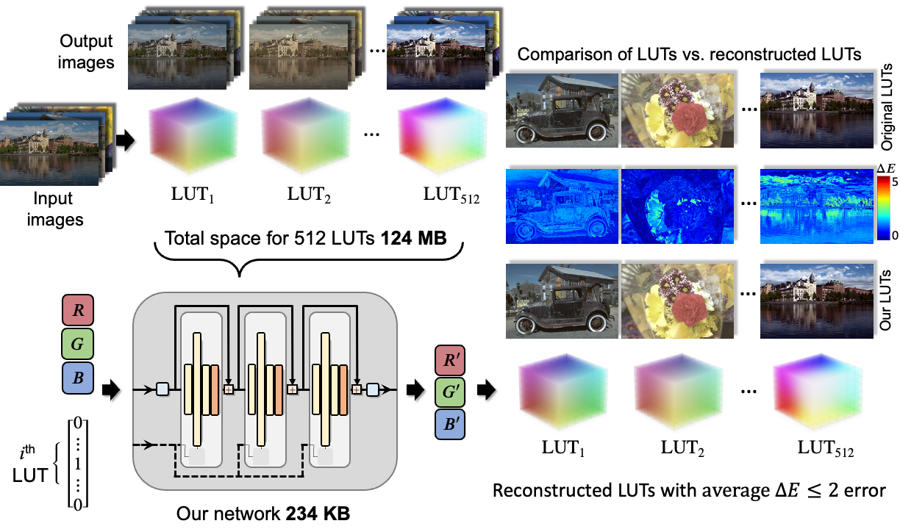

# Efficient Neural Network Encoding for 3D Color Lookup Tables

<p align="center" markdown="1">
    <span >
        
    </span>
</p>

<p align="center" markdown="1">
    <a href="https://arxiv.org/abs/2412.15438">
        
    </a>
     <a href="./data">
        
    </a>
     <a href="https://patents.google.com/patent/US20250168291A1/en">
        
    </a>
</p>

<p align="center">
  <a href="#how-to-use">How to Use</a> •
  <a href="#data">Data</a> •
  <a href="#experiments">Experiments</a> •
  <a href="#license">License</a> •
  <a href="#cite">Cite</a>
</p>

This repository contains the official implementation and experiment configs for **Efficient Neural Network Encoding for 3D Color Lookup Tables**, published at AAAI 2025.

EnneLUT learns a compact neural representation for collections of 3D color lookup tables (LUTs). The paper focuses on encoding hundreds of LUTs with a small PyTorch model, evaluating reconstruction quality on full-gamut Hald images and natural image colors, and exploring invertible LUT representations.

This work is associated with [US patent application US20250168291A1](https://patents.google.com/patent/US20250168291A1/en).

## How to Use

This project targets Python `3.11`. Install the package with:

```bash
pip install -e .
```

For development utilities, including Ruff and the data-crawling tools:

```bash
pip install -e ".[dev]"
```

Run a single experiment:

```bash
python main.py individual --config experiments/example.yaml
```

Run a sweep:

```bash
python main.py sweep --config experiments/sweeps/uniform_scaling.yaml
```

Inspect the CLI:

```bash
python main.py --help
```

## Data

The paper uses LUTs gathered from FreshLUTs and images from MIT-Adobe FiveK. The repository documents the acquisition process and helper scripts, but does not assume those datasets are already present.

- [LUT data notes](./data/luts/README.md): LUT sources, FreshLUTs tooling, sorting utilities, and notes on which LUTs were used for paper results.
- [Image data notes](./data/images/README.md): MIT-Adobe FiveK image splits and the download helper for selected image IDs.

The experiment configs generally expect local paths like:

```text
data/luts/freshluts/luts/*.cube
../images/split-1/*.png
```

Adjust paths in the YAML configs if your local data layout differs.

## Experiments

The main entrypoint is [main.py](./main.py). It supports individual configs and W&B sweeps.

Useful configs:

- [experiments/example.yaml](./experiments/example.yaml): small CPU-oriented example config.
- [experiments/sweeps/uniform_scaling.yaml](./experiments/sweeps/uniform_scaling.yaml): uniform-training model-size and LUT-count sweep.
- [experiments/sweeps/distribution.yaml](./experiments/sweeps/distribution.yaml): color-distribution and objective sweep.
- [experiments/sweeps/architecture_search.yaml](./experiments/sweeps/architecture_search.yaml): architecture search.
- [experiments/baseline/best_nilut.yaml](./experiments/baseline/best_nilut.yaml): baseline comparison config.
- [experiments/baseline/ablation_sweeps](./experiments/baseline/ablation_sweeps): ablation sweeps.
- [experiments/invertible](./experiments/invertible): invertible LUT configs and architecture search.

Most paper-scale configs assume a GPU and W&B logging. The example config uses CPU by default, but still expects local LUT data.

## Implementation

The model is implemented in PyTorch. Training uses [PyTorch Lightning Fabric](https://lightning.ai/docs/fabric/stable/) with a custom config structure in `ennelut.training.config`. Dynamic class paths in YAML configs are resolved with [dypy](https://github.com/vahidzee/dypy), so config values such as `ennelut.model.layers.LipSwish` refer directly to package objects.

Project layout:

- [ennelut](./ennelut): package source code.
- [experiments](./experiments): runnable YAML configs and sweeps.
- [data](./data): dataset notes and acquisition tooling.
- [assets](./assets): README and project assets.

## Development

Lint and format with Ruff:

```bash
ruff check .
ruff format .
```

## License

The code in this repository is released under the [Apache License 2.0](./LICENSE). We encourage using this work, experimenting with it, and building on top of it.

If you plan to commercialize a product or service based on this work, please also consider the associated [US patent application US20250168291A1](https://patents.google.com/patent/US20250168291A1/en) and the licenses of any LUT or image datasets you use. The LUT collections documented in this repository come from third-party sources with their own terms, and the paper experiments were limited to Creative Commons licensed LUTs gathered from FreshLUTs.

## Cite

```bibtex
@inproceedings{zehtab2025efficient,
  title={Efficient neural network encoding for 3D color lookup tables},
  author={Zehtab, Vahid and Lindell, David B and Brubaker, Marcus A and Brown, Michael S},
  booktitle={Proceedings of the AAAI Conference on Artificial Intelligence},
  volume={39},
  number={9},
  pages={9772--9779},
  year={2025}
}
```
